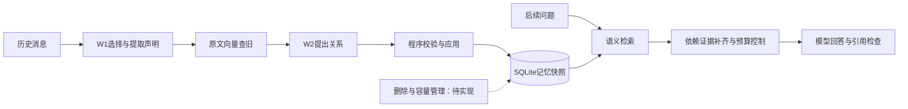

# D.I.V.E.首版技术方案与阶段验证

Long-term AI Interactive Memory System

版本：v1.0评审稿｜日期：2026-11-17｜用途：导师技术方案评审

## 1. 产品定位与范围

DIVE是供聊天应用接入的独立Python记忆组件，交付命令行入口和LongMemEval适配器。应用将允许使用的历史交给DIVE；后续提问时取得相关记忆及原文依据，再由模型回答。模型经适配器调用，记忆逻辑不绑定单一服务；目前真实调用只验证了DeepSeek。

用户先住成都，后来搬到杭州，又去上海出差。系统应区分历史住所、当前住所和临时事件，减少重复交代背景，并支持追查回答依据。

首版覆盖选择性积累、更新、检索、复用和遗忘。CLI满足交互入口需求；暂不增加网页插件、MCP、图数据库、多智能体或模型微调。当前代码是设计验证程序，通用增量交互与遗忘功能尚待实现。

## 2. 架构与选型

| 部分 | 选择与理由 |
|---|---|
| 实现与存储 | Python、SQLite，适合本地运行、事务保存和检查复现 |
| 语义检索 | 本地BGE-M3，已在现有CPU验证；原文和问题编码为归一化向量，按点积排序 |
| 文本模型 | 独立适配器，当前为`deepseek-flash`，关闭思考模式；记录返回型号及用量 |
| 记忆依据 | 声明保存来源、时间和有效状态，记忆组只保存支持声明编号 |
| 故障处理 | 校验、调用记录及历史返回复用；拒绝伪造引用，关系不确定时保留待核 |

## 3. 数据与核心流程

原文片段保存来源会话、日期、逐条角色、原始文本和消息位置。声明包含独立编号、主体、属性、值、适用范围、语气、肯否、时间和逐字引用。记忆组以`support_ids`关联声明。关系保存支持、变化、纠错、撤回或待确认判断及依据。

SQLite保存原文、声明、编号组、关系和向量。目前使用验证快照，已检查关闭并重开后的内容一致性。正式增量入口将在此模型上实现按空间读写，来源与批次编号须在空间内稳定且不重复。

1. **历史整理。**按来源日期稳定排序，保留角色和位置；长消息切为不超过512个BGE Token的片段，不静默截断。消息时间与事件时间分开，未知时间不补造。
2. **W1写入准备。**模型选择信息并提取声明；程序检查字段、来源、角色、日期及逐字引用。引用位置可由程序在指定消息中定位，保留必要上下文。
3. **查旧。**对新信息检索最多8个原文候选，再关联旧记忆。W2每次最多4条新声明、32条旧记忆，按完整请求大小缩小批次或候选；候选裁剪须标记覆盖不足。
4. **关系与更新。**W2提出操作，程序校验后应用。支持要求同一事实，事件还需确认同一次事件；变化要求同属性、互斥实际状态及可靠先后，方向由程序计算。纠错或撤回定位具体声明，其他独立依据继续有效。矛盾提案保留待确认，不强行关闭旧事实。
5. **持久化。**保存声明、编号组、关系和向量；记忆组状态、时间范围与冲突由有效声明及关系统一计算。
6. **检索回答。**问题检索最多8个原文候选，补齐关键支持观察、上下文及相关变化/纠错依据。证据最多8个片段、16 KiB，同时保证完整请求不超过24 KiB；装不下时省略完整依赖组并标记不完整。回答仅使用提供的证据，程序检查格式和引用编号。

完整请求预算包括提示、数据和JSON封装；字符/字节数不等于模型Token数。W1、W2、回答输出上限分别为4096、2048、512 Token。上述参数为工程初值，正式评测前记录并冻结。

来源非法、结构损坏与接口故障分别记录，无自动重试。关系待确认不表示原文一定为假。请求、返回和用量在校验前取证，已返回的失败用量保留，缺失字段标未知。

已有返回在来源、声明编号、候选和配置经核验后才能复用。提示或规则变化后的复核标记为历史重新校验，不视为新提示已通过真实模型验证。当前仅支持指定单题Oracle记录的受限恢复。

## 4. 遗忘与容量设计（待实现）

支持按记忆空间或原文片段删除。清理目标及必须依赖它的声明、空记忆组、关系与向量，保留其他独立依据和仍有效的历史。

删除较新信息后，不能自动将旧观察认定为当前事实。必要时保留不含被删原文的失效边界标记；当前依据不足时回答未知。不能为防止旧状态复活而默认删除整条历史版本链。删除前计算影响范围，操作结果返回实际删除及失效对象。

每空间容量开发初值为1,000个原文片段，可配置。超限时优先清理最旧且可独立移除的历史记忆组，仍被有效信息依赖的内容保留。无法安全释放空间时停止新增写入并报告容量不足。这可能使库满后暂停积累，属于首版限制；通过缩小容量的案例验收，无需单独证明初值最优。

删除后递增空间版本，使旧快照和恢复记录失效，防止自动重建被删信息。实验日志独立归档，不参与回答；首版不承诺归档日志的安全擦除。

验收：目标不可再检索、独立历史不被误删、旧状态不复活、旧快照不能恢复目标，以及容量超限行为符合规则。

## 5. 环境与依赖

Windows、Python 3.12.16、SQLite（Python标准库）、PyTorch 2.15.0+cpu、Sentence Transformers 6.2.0、Transformers 5.22.2、NumPy 2.5.4、Hugging Face Hub 2.4.0。

BGE-M3固定修订`5617a9f61b028005a4858fdac845db406aefb181`，CPU最多8线程、批量2条、长度上限512 Token。初次需下载，后续验证仅加载缓存。密钥在本机隐藏输入，不写入代码和日志。安装、数据获取和命令见README。

## 6. 已完成验证与边界

- 80项离线测试通过，覆盖来源、时间、部分纠错、冲突、持久化、证据依赖、预算、恢复和用量。
- 1题真实Oracle完整调用链完成：33条声明保存并重开一致；回答为GPS故障，人工核对与参考答案含义一致，引用有原文支持；尚未运行官方Judge。
- 本题为30次新增、3次待确认，没有成功执行支持合并、变化、纠错或撤回，不能据此认定这些机制已通过真实评测。
- 续跑复用7条旧返回，新增8次调用、55,612 Token。两次真实运行累计15次调用、87,867 Token，模型请求耗时44.13秒，不含本地加载等时间。
- 证据预算省略1个片段，人工检查不影响本题；其他题型的覆盖效果待验证。

记录依据：`runs/design-validation/acceptance-20261114-165233/`及`runs/design-validation/20261114-100213-20bafda1/`。本地原始记录不随仓库上传，关键结果在本文汇总。

## 7. Oracle评测与预算

采用手册指定的Oracle数据500题，各实例隔离。数据版本与SHA256见`data/README.md`。摄入只使用来源、日期、角色和原文，不传未来问题、参考答案、题型或答案位置标签；回答时才提供问题及提问日期，不将全部历史拼入回答上下文。

先以覆盖六类题型的少量开发题检查机制与成本，再冻结配置、分批完成500题及项目组统一Judge评分。JSONL每行含`question_id`和字符串`hypothesis`，检查500个ID完整且唯一。报告整体、分题型、拒答表现、检索延迟、Token、费用、耗时与失败模式。批量入口复用已加载编码器，并隔离各题记忆。

预算按2026-11-14核对的官方价格估算，不是账单实测。DeepSeek Flash每百万Token：未命中输入空闲/高峰1/2元，缓存输入0.02/0.04元，输出4/8元。

以当前单题同负载、输入全部按未命中计，500题单轮约59—118元；增加50%预留，暂列答题预算90—180元。这是跨两次运行的开发样本，不能代表500题平均负载，扩量前修订估算。开发调试和额外全量复跑另计；本地嵌入不产生嵌入API费用。

Judge型号、版本和渠道待项目组确认。仅以GPT-4o列价作示例：每百万输入2.5美元、输出10美元；假设每题2,000输入、100输出Token，500题约3美元，暂预留6美元。该页面已标注Deprecated，实际型号与可用性以项目组安排为准。

- [DeepSeek官方价格](https://api-docs.deepseek.com/zh-cn/quick_start/pricing/)
- [GPT-4o官方列价](https://developers.openai.com/api/docs/models/gpt-4o)

## 8. 后续实施与交付

| 顺序 | 工作与验收 |
|---|---|
| 首版评审 | 同步方案、README、代码和测试，通过PR供导师查看，确认Judge配置 |
| 最小系统 | 完成增量交互、删除、容量及批量入口；跨会话写入、重开、查询与删除状态一致 |
| 少量真实验证 | 补充真实更新、纠错及各题型案例，按实际错误决定修改，不强制增加多路线对比 |
| 正式评测 | 冻结配置，完成500题与统一评分，保存预测、成本和失败分析 |
| 最终交付 | 可运行组件、架构文档、评估报告、复现说明和答辩演示相互一致 |

技术路线和数据模型采用上述首版设计；效果、性能和参数按后续验证迭代。删除、容量和通用增量交互为已设计、待实现内容。

## 依据

项目要求依据《DIVE-Student-Handbook.pdf》v1.6及导师沟通；技术选型为个人方案。参考LongMemEval的indexing/retrieval/reading视角定位错误。

- [LongMemEval论文](https://arxiv.org/abs/2410.10813)
- [官方代码与评测](https://github.com/xiaowu0162/LongMemEval)
- [BGE-M3](https://huggingface.co/BAAI/bge-m3)
- [项目仓库](https://github.com/FeFe0217/dive-memory)
